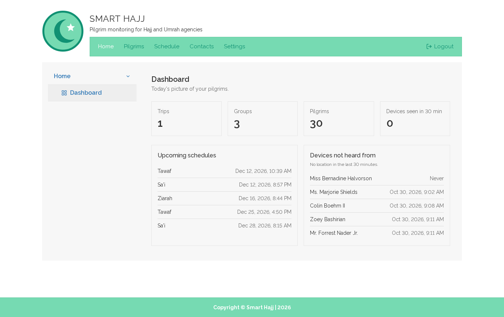
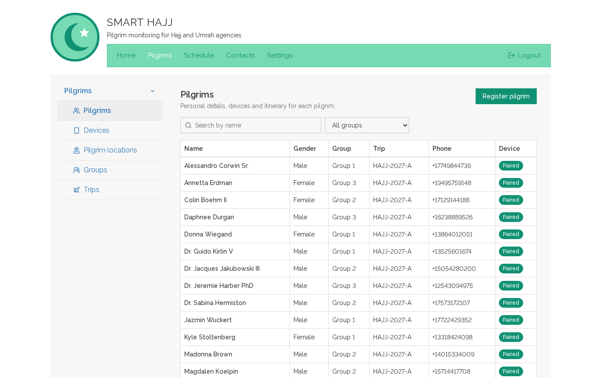
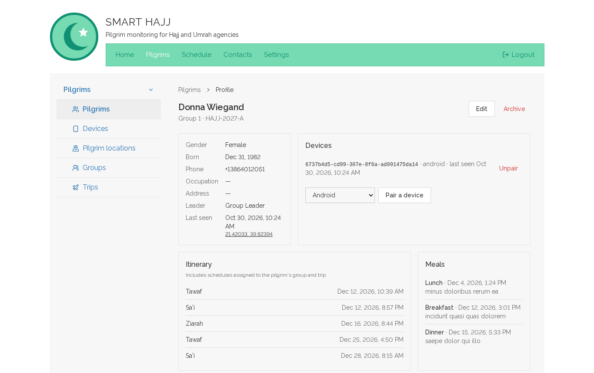
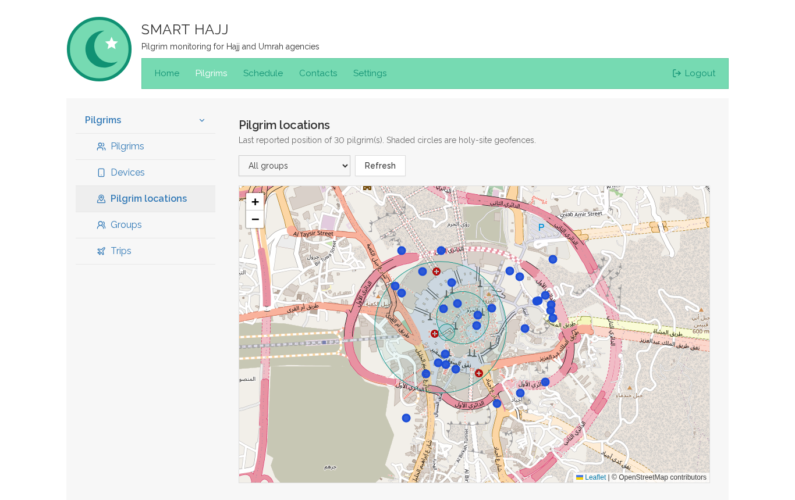
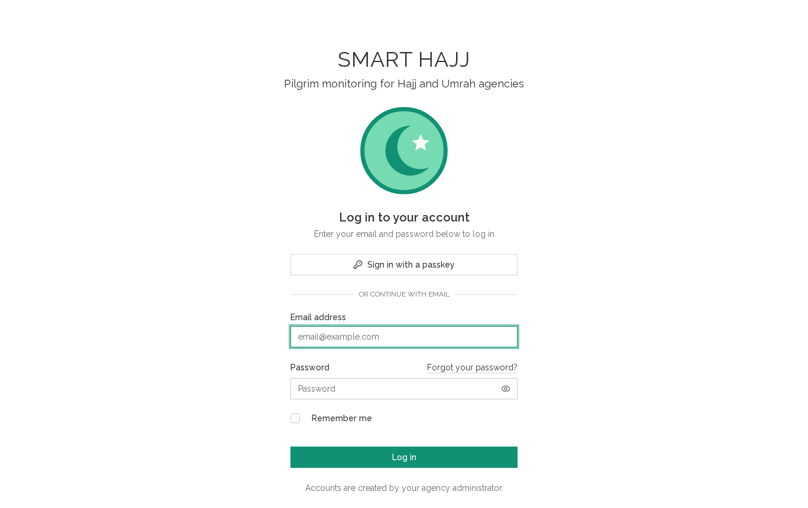

# Smart Hajj

An admin panel and pilgrim-app API for Hajj and Umrah travel agencies. It covers trips, groups, pilgrims, itineraries, meals, contacts, paired phones, live pilgrim locations, and alerts when a pilgrim reaches a holy site.

A from-scratch rewrite of a 2017 plain-PHP Umrah admin panel and a 2020 Laravel 8 API. No original client code or data is included.

## Screenshots

**Dashboard**



**Pilgrims**



**Pilgrim profile with devices, itinerary and meals**



**Last reported positions and holy-site geofences**



**Sign-in**



## Features

- **Roles**
    - **System admin:** manages agencies, staff accounts, and the holy sites with their prayers.
    - **Agency admin:** manages their own agency's trips, groups, pilgrims, schedules, meals, contacts, devices and staff.
    - **Group leader:** sees their own groups' pilgrims and positions, read-only.
- **Itineraries that inherit:** a schedule or meal can be assigned to a whole trip, a group, or one pilgrim. Each pilgrim sees everything that applies to them, once.
- **Pilgrim locations:** a map shows each pilgrim's last reported position, with the holy-site geofences drawn around them.
- **Device pairing:** pairing a phone from a pilgrim's profile issues a revocable Sanctum token, shown once. Unpairing signs that phone out immediately.
- **Time zone:** all times are stored and shown in `APP_TIMEZONE` (Asia/Riyadh by default), so staff anywhere read the same schedule.

## Pilgrim app API (`/api/v1`, device token)

| Method | Path         | Returns                                                                     |
| ------ | ------------ | --------------------------------------------------------------------------- |
| GET    | `/me`        | Pilgrim, group, leader and trip                                             |
| GET    | `/schedules` | Every schedule that applies, including inherited ones                       |
| GET    | `/meals`     | Every meal that applies                                                     |
| GET    | `/contacts`  | Agency contacts plus the pilgrim's own group's                              |
| GET    | `/places`    | Holy sites with their prayers                                               |
| POST   | `/locations` | Stores a location fix and returns any holy sites just entered, with prayers |
| DELETE | `/token`     | Signs the phone out                                                         |

## Design

The interface follows the original Smart Umrah panel, rebuilt in Tailwind: a header with the emblem and title, a mint top menu, a grey content area with each section's menu on the left, square Bootstrap 3 controls and Raleway type. Light theme only, as the original was.

## Stack

Laravel 13 · PHP 8.4 · Inertia 3 + Vue 3 + TypeScript · Tailwind 4 · Fortify (passkeys, 2FA) · Sanctum · Leaflet + OpenStreetMap · PHPUnit · Larastan level 7

## Development

```bash
composer run setup
php artisan migrate:fresh --seed
composer run dev
```

Demo sign-ins (password `password`):

| Email                | Role         |
| -------------------- | ------------ |
| `admin@example.com`  | System admin |
| `agency@example.com` | Agency admin |
| `leader@example.com` | Group leader |

The seeder adds 10 holy sites. Their coordinates are approximate and their geofence radii are rough working values. It adds no prayer texts; enter those through the admin panel from a trusted source.

```bash
php artisan test
composer run types:check   # Larastan
npm run check && npm run types:check
```
